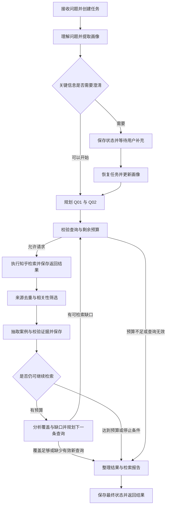

# 人生实验室检索 Agent 工作流设计

版本为第三版，落实已确认的分配额检索、字段加权评分、提前结束及前端统计调整。运行与评分规则以 README 和当前实现为准。

## 1. 目标与交付内容

检索 Agent 根据用户的人生选择问题，理解背景与约束，检索知乎经历，整理可追溯案例，并输出当前证据的覆盖情况与剩余缺口。

一次任务的交付内容包括用户画像、结构化案例、字段级证据、来源索引、查询记录、覆盖情况和结束原因。未来自我 Agent 与实践 Agent 可以通过任务 ID 读取这些结果。

### 已确认的工作流约束

- 所有模型节点统一使用 `deepseek-flash`。
- 使用 LangGraph 表达节点、条件分支、循环和人工澄清。
- 用户信息不足且会影响查询方向时，先澄清再检索。
- 首轮规划 Q01、Q02，根据返回的证据缺口决定 Q03、Q04。
- 单次任务最多执行四次知乎检索请求，同时受时间和 Token 预算约束。
- 达到预算上限后输出已获得的结果和剩余缺口。
- 案例抽取保留来源和证据，结果持续写入数据库。
- 前端与检索 Agent 同步开发，首版页面围绕经历检索展开，后续随 Agent 能力扩展。
- 前端实时呈现实际执行轨迹，支持查看历史任务、补充澄清和恢复任务状态。

### 本稿新增的建议值

| 配置项 | 建议初始值 | 说明 |
|---|---|---|
| 单次任务搜索请求上限 | 4 次 | 建议将失败请求与重试纳入计数 |
| 每次请求结果数 | Q01/Q02/Q03/Q04 分别 10/6/5/5 条 | 后续查询按关键缺口执行，覆盖充分时提前结束 |
| 搜索并发上限 | 2 | 首批互补查询可以并发，补查依赖前批结果 |
| 任务活跃执行时间预算 | 180 秒 | 包含模型、搜索与结果处理，用户等待澄清的时间暂停计时 |
| LLM 累计 Token 预算 | 100,000 | 汇总所有模型节点及重试的输入与输出用量 |
| 收尾时间预留 | 10 秒 | 为已有结果整理和持久化保留时间 |
| 结构化输出修复次数 | 最多 1 次 | 仍受剩余时间和 Token 预算约束 |
| 默认澄清次数 | 1 次集中澄清 | 一般包含 1—3 个影响查询方向的问题 |

时间、Token 与四次请求预算共同生效，集中澄清等待期间暂停计时。返回内容按背景相关性排序，分批抽取和核验，记录待完成分析来源。

## 2. 总体流程

图中首轮包含两次请求，Q03、Q04 分别在前一批处理后按需生成。检索请求计数达到四次时，已返回的最后一批结果仍在剩余处理预算内完成抽取，然后进入收尾。

## 3. 节点详细设计

### 节点 A 接收问题与初始化

程序生成 `run_id` 和 LangGraph 使用的 `thread_id`，保存用户原始输入，并创建任务记录。每个任务独立维护画像版本、查询历史、预算和结果引用。

任务初始状态为 `running`。重启或恢复任务时读取已保存的计数和结果，沿用原任务的预算。

### 节点 B 理解问题与提取画像

LLM 输出结构化画像，程序使用 Pydantic 校验字段、枚举值和必需结构。

| 字段 | 含义 | 处理原则 |
|---|---|---|
| `background` | 专业、教育阶段、工作经历、已有能力 | 保存原话依据，具体学位未知时保留未知 |
| `goals` | 希望进入的领域、岗位或达到的状态 | 标记尚待确认的解释 |
| `decision_question` | 本次真正需要探索的问题 | 例如在读如何准备 AI 实习 |
| `planned_actions` | 打算采取的行动 | 与已经完成的行动分别保存 |
| `completed_actions` | 已完成的学习、项目或投递 | 只记录用户提供的经历 |
| `observed_outcomes` | 已发生的结果与反馈 | 用户尚未提供时允许为空 |
| `constraints` | 时间、资金、地点、学业等限制 | 只收集对当前问题有影响的信息 |
| `alternatives` | 用户正在比较的路径 | 仅在问题涉及路径比较时使用 |
| `unknowns` | 尚未明确的信息 | 记录是否会影响查询方向 |

每个重要字段保留 `value`、`source_text` 与来源类型。来源类型可以是用户原话、用户澄清或待确认的模型解释。后续节点使用用户已确认的字段构造关键查询条件。

检索材料中的指令性内容作为待分析文本处理，工具调用由工作流状态和程序规则控制。

### 节点 C 判断澄清必要性

LLM 提出需要澄清的字段及其影响，程序根据任务要求决定是否中断。

适合触发澄清的情形包括目标存在明显歧义、正在比较的决策路径不清晰，以及缺少会显著改变检索方向的限制条件。

例如，“转 Agent”可能指向开发岗位或学习 AI 工具。“想转行”也可能涉及在读准备、毕业求职或休学选择。用户想探索的具体问题需要先确认。

已完成行动、最终结果或其他可选字段允许为空。提问时说明补充信息的用途，并允许用户回答“暂不确定”。仍有不确定项时，使用用户确认的探索范围开展检索，输出中保留这些不确定项。

### 节点 D 人工澄清与恢复

澄清节点调用 `interrupt()`，将问题、待补字段和当前理解返回给交互端。任务状态更新为 `awaiting_input`，计时暂停。

用户提交补充后，通过同一 `thread_id` 与 `Command(resume=...)` 恢复任务，更新画像版本并继续累计活跃执行时间。画像解析和查询请求安排在独立节点，便于处理中断节点恢复时的重新执行。[LangGraph Interrupts](https://docs.langchain.com/oss/python/langgraph/interrupts)

澄清回答按当前待补字段进行验证。回答缺少可选信息时继续处理，目标仍存在关键歧义时返回需要补充的具体项目。

### 节点 E 规划首批查询

Q01 以最接近用户的背景与目标寻找经历。Q02 提供互补覆盖，例如有记录地扩大专业范围，或补充一条用户正在考虑的行动路径。

| 编号 | 示例查询 | 目的与条件 |
|---|---|---|
| Q01 | 生物专业 研究生 AI Agent 开发 在读实习 经历 | 保留原始背景与目标 |
| Q02 | 非计算机专业 研究生 AI开发 自学 项目 实习 经历 | 扩大专业范围，保留研究生阶段和实习目标 |

示例对应用户已确认“优先在读找 AI 开发实习”的情形。具体查询由当前任务的画像决定。

每条查询包含 `query_text`、`purpose`、`target_gap`、`preserved_fields`、`relaxed_fields` 和 `profile_version`。

所有查询都从同一份当前画像生成。放宽条件需要明确记录，模型输出经程序校验后进入请求队列。教育阶段等关键字段通过画像和受控同义表达构造，避免将研究生改成本科生。

### 节点 F 查询校验与预算准入

程序检查以下条件。

1. 查询目的与本次核心问题相关，关键条件与画像一致。
2. 放宽的字段在当前策略允许范围内，并已记录理由。
3. 查询与本次已完成查询存在有效差异。
4. 存在剩余搜索请求槽位、活跃时间和模型处理预算。
5. 已为这批返回结果的抽取与最终收尾留出预算。

无效查询允许在预算内修复一次。无法修复时记录原因，携带已有结果进入收尾。

搜索请求发送前预占一个请求槽位。并发请求使用共享计数，确保同一任务的真实请求总数受四次上限控制。

### 节点 G 执行知乎搜索

建议使用异步 HTTP 客户端直接调用知乎搜索 API。

| 项目 | 接入方式 |
|---|---|
| 方法与地址 | `GET https://developer.zhihu.com/api/v1/content/zhihu_search` |
| 鉴权 | `Authorization` Bearer 凭证及 `X-Request-Timestamp` 秒级时间戳 |
| 主要参数 | `Query`、`Count` 与按需使用的 `SortBy` |
| 返回数量 | Q01/Q02/Q03/Q04 分别 10/6/5/5 条 |
| 主要返回内容 | 摘要、内容类型、内容 ID、作者、原始链接、时间和互动量 |

此前阅读的官方文档将 `ContentText` 定义为摘要，`Count` 最大为 10，API 页说明当前 `HasMore` 固定返回 `false`。实现时以实际响应核对这些约束。[知乎搜索 API](https://developer.zhihu.com/docs?key=zhihu_search)

收到响应后保存请求参数、响应状态、接口请求标识、耗时和每条返回快照。凭证从环境配置读取，日志记录使用可追踪的任务 ID 与请求 ID。

建议四次上限包含失败请求和重试。例如前三次请求中有一次用于重试，任务剩余一个请求槽位。请求编号按实际发送顺序记录，重试关联原查询，报告显示各次请求的用途与结果。

### 节点 H 来源去重与相关性筛选

来源优先使用 `ContentType + ContentID` 标识，缺少标识时使用规范化链接辅助去重。展示与引用保留接口返回的原始链接。

来源去重后仍保存查询与返回快照的关联。同一来源可能因查询不同返回新的摘要片段，新增片段可以补充案例证据。

相关性筛选检查人物背景、目标方向、具体行动和经历叙述。建议保留“相关经历”“相关观点”“信息不足”“无关”等标签。相关观点可以辅助理解环境，实际经历进入案例集合。

作者昵称只作为展示信息。跨来源关联同一人物，需要明确来源依据。一个来源出现多个人物时，分别保存各段经历的主体及证据。

### 节点 I 案例抽取与证据校验

LLM 批量提取有价值的候选材料，生成背景、行动顺序、阶段结果、时间成本和适用差异。默认每批处理有限数量的摘要，控制单次上下文长度。

| 案例字段 | 保存内容 |
|---|---|
| `person_context` | 来源明确描述的人物背景与限制 |
| `actions` | 已发生的行动和可确认的顺序 |
| `stage_outcomes` | 获得面试、获得实习、仍在求职等已交代结果 |
| `time_and_cost` | 明确提到的耗时、投入与代价 |
| `event_time` | 经历发生的时间，可为空 |
| `applicability` | 与当前用户相近和不同的条件 |
| `source_nature` | 作者自述、他人转述或信息不足 |
| `evidence_refs` | 每个重要字段对应的证据引用 |

证据至少关联 `case_id`、`field_name`、`search_hit_id`、`quote` 和 `evidence_scope`。原始摘要与去除高亮标签后的清洗文本分别保存，引用校验基于可复现的文本版本。

程序检查引用片段是否存在、来源索引是否有效和结构是否符合契约。语义校验检查该片段是否足以支持提取字段。重要错误通过针对性的人工抽样复核发现和调整。

摘要未提及的耗时、薪资或最终结果保留未知。内容发布时间、更新时间和经历发生时间分别保存。

结构化输出建议使用 DeepSeek JSON Output 配合 Pydantic 校验。遇到空白、截断或字段错误时，在预算允许范围内修复一次，并保留错误记录。[DeepSeek JSON Output](https://api-docs.deepseek.com/guides/json_mode/)

### 节点 J 覆盖评估与动态补查

覆盖评估围绕用户当前问题进行。对于“在读准备 AI 实习”的问题，可以检查相近背景、准备行动、结果、时间投入和求职受阻情况。涉及多路径决策时，再按用户正在比较的路径建立覆盖矩阵。

每项覆盖状态为“证据明确”“证据不完整”“结果未交代”或“尚未找到”，并关联支持该状态的案例和字段。

LLM 在一次调用中给出覆盖情况、优先缺口和建议的下一条查询。程序检查其价值与预算后决定是否执行。

| 缺口示例 | 建议处理 |
|---|---|
| 相近背景材料很少 | 有记录地扩大专业或其他次要条件 |
| 只有顺利转行的经历 | 补查求职困难或行动受阻的经历 |
| 时间投入描述不足 | 针对学习周期与投入时间检索 |
| 用户尚不清楚自己是否喜欢开发 | 记录为待实践验证的问题，交接实践 Agent |
| 摘要始终未说明最终结果 | 保留缺口，结合剩余预算判断补查价值 |

Q03、Q04 逐次生成，每次明确希望新增什么证据。第四次请求完成后，根据剩余预算处理已返回材料，再进入报告节点。

### 节点 K 生成报告与交接结果

报告内容包括用户问题与约束、相关案例、关键证据、适用差异、覆盖矩阵、剩余缺口、查询记录、资源用量和结束原因。

基础统计和覆盖状态由程序汇总。若预算充足，LLM 可以整理带来源索引的可读摘要。模型预算耗尽或调用失败时，使用已保存的数据生成模板报告。

其他 Agent 接收 `run_id`、画像版本、案例引用、证据引用、覆盖状态和待验证问题。通过稳定的结构化字段读取交接内容。

## 4. 预算、停止与异常处理

### 时间与 Token 管理

活跃时间从任务开始处理时累计，覆盖画像解析、查询规划、搜索、抽取和分析。人工等待期间暂停，恢复后继续累计。向外部服务发起请求时，超时取节点上限与剩余预算允许值中的较小值。

建议在工作预算剩余 10 秒时停止发起新的外部调用，使用已有数据收尾。任务应记录实际耗时，网络取消和持久化开销仍需在真实运行中测量。

Token 使用按服务端返回的用量累计，包括输入、输出及重试。推理 Token 如果已包含在输出总量中，汇总时避免重复加算。响应缺少用量时记录估计值和估计标志，避免将其显示为精确统计。

每次模型调用前检查剩余预算、估算输入开销，并限制输出长度。100,000 Token 是默认调度阈值，输入估算误差及失败请求的计费信息可能影响实际用量，须在报告中标明统计依据。

当前统一模型入口的 SDK 自动重试默认值为 2。工作流实现时建议在该调用路径关闭隐藏重试，由预算控制器管理重试及计数。

### 停止规则

| 条件 | 后续动作 | 结束原因 |
|---|---|---|
| 四次搜索请求已使用 | 处理已返回结果后收尾 | `request_limit` |
| 活跃时间预算不足 | 保存进度并以已有数据收尾 | `time_budget` |
| 剩余模型预算不足 | 使用结构化数据生成报告 | `token_budget` |
| 关键维度已有足够证据 | 提前收尾 | `coverage_met` |
| 连续两批处理未产生新增有效证据 | 保留未解决缺口并结束 | `no_new_evidence` |
| 无法规划有效的新查询 | 输出已有结果与策略限制 | `no_valid_query` |
| 持续接口故障或凭证失败 | 保存可用结果和错误 | `service_error` |
| 用户取消 | 保存已完成部分 | `cancelled` |

新增有效证据既包括新案例，也包括同一来源新增的关键字段证据。一批有多个请求时，在整批处理结束后评估新增量。

### 任务状态与结果状态

任务状态使用 `running`、`awaiting_input`、`finished`、`failed` 和 `cancelled`。任务结束后另存结果状态。

| 结果状态 | 含义 |
|---|---|
| `complete` | 本次关键覆盖要求已达到 |
| `partial` | 已完成处理，仍有明确证据缺口 |
| `empty` | 成功完成的查询中未获得可用案例 |
| `unavailable` | 服务或配置错误导致无法完成有效检索 |

例如，四次查询后仍有缺口，可以记录任务状态 `finished`、结果状态 `partial`、结束原因 `request_limit`。已获得的观点材料和查询记录仍随结果返回。

### 可恢复错误

- 参数或鉴权错误记录明确原因，停止继续发送同类请求。
- 限流、超时或临时服务错误仅在有剩余请求和时间预算时重试。
- 部分来源抽取失败时保留原始快照，其他有效案例继续输出。
- 工作流恢复时复用已完成的请求和抽取结果，持久化采用唯一约束与幂等写入。
- 外部调用成功后、结果尚未持久化时若进程中断，可能无法确认远端用量。恢复时将该请求标记为结果未知，并保留已占用预算。

## 5. 数据库设计

建议第一版采用 SQLite，业务数据与 LangGraph 检查点分别使用清晰的表或独立数据库文件管理。业务层保存可查询的案例和报告，checkpointer 保存执行状态以支持中断恢复。[LangGraph Persistence](https://docs.langchain.com/oss/python/langgraph/persistence)

### 建议的业务表

| 表 | 主要内容与索引 |
|---|---|
| `runs` | 任务 ID、用户输入、画像与版本、澄清信息、状态、预算、报告和结束原因 |
| `queries` | 请求序号、查询目的、请求参数、重试关联、预占状态、耗时和错误 |
| `sources` | 来源身份、内容类型、内容 ID、作者与原始链接，来源身份建立唯一约束 |
| `search_hits` | 查询 ID、来源 ID、原始及清洗摘要、快照哈希、排序和抓取时间 |
| `cases` | 任务 ID、经历主体、结构化经历、适用差异和抽取版本 |
| `evidence` | 案例字段、返回快照 ID、证据片段与证据范围 |
| `run_events` | 任务 ID、递增序号、节点、执行片段、查询关联、事件类型、时间与展示载荷，任务与序号建立唯一约束 |

同一来源的多次命中关联到不同快照。案例数量按独立经历计算，来源数量和证据片段数量单独统计。

每批数据及时保存，写事务保持短小，模型和网络调用在事务外执行。使用 WAL、外键和适当的忙等待设置，写入仍需协调同一时刻的单个写入者。数据库文件部署到持久化磁盘。[SQLite WAL](https://www.sqlite.org/wal.html)

如果正式部署采用多实例服务，或平台无法提供合适的持久化本地磁盘，建议在部署前采用 PostgreSQL 与对应的 LangGraph checkpointer。当前 SQLite 建议基于单实例原型和参赛演示的工作量判断。

## 6. 建议技术栈

| 层次 | 建议技术 | 在本项目中的作用 | 当前情况 |
|---|---|---|---|
| 运行环境 | Python 3.12、项目 `.venv` | 运行工作流及工具调用 | 已配置 |
| 工作流 | LangGraph | 节点编排、条件路由和循环 | 待安装与实现 |
| 人工澄清 | LangGraph `interrupt`、`Command` | 暂停并恢复同一任务 | 待实现 |
| 模型接入 | `langchain-openai`、`deepseek-flash` | 统一模型入口，支持异步调用 | 已配置 `llm.py` |
| 数据契约 | Pydantic 2 | 校验画像、查询、案例和报告结构 | 环境中已作为依赖安装 |
| 搜索客户端 | HTTPX 异步客户端 | 直接调用知乎 API，控制超时与并发 | 环境中已作为依赖安装 |
| 并发控制 | Python `asyncio` | 限制首批并发与管理取消 | 标准库 |
| 业务数据库 | SQLite、Python `sqlite3` | 保存任务、查询、案例与证据 | 标准库，表结构待实现 |
| 检查点 | `langgraph-checkpoint-sqlite` | 保存图状态与支持恢复 | 待安装与接入 |
| 环境配置 | `python-dotenv` | 读取项目 `.env` 和进程环境 | 已配置 |
| 日志与报告 | Python `logging`、结构化 JSON | 跟踪节点、耗时、用量与错误 | 标准库，待接入 |
| 后端接口 | FastAPI、Uvicorn | 创建任务、读取状态、提交澄清、订阅轨迹与读取报告 | 与工作流同步实现 |
| 前端基础 | React、TypeScript、Vite | 建立可持续扩展的 Web 工作区 | 与工作流同步实现 |
| 样式与组件 | Tailwind CSS、shadcn/ui | 输入、表单、时间线、折叠详情与来源展示 | 按实际页面需要引入 |
| 页面路由 | React Router | 经历检索、历史任务及后续 Agent 页面 | 与前端同步实现 |
| 服务端数据状态 | TanStack Query | 任务列表、任务快照、报告及澄清提交 | 与前端同步实现 |
| 实时事件 | SSE、浏览器 EventSource | 向页面推送持久化后的运行事件 | 与工作流同步实现 |

业务数据可先通过 `sqlite3` 与参数化 SQL 保存。接入 PostgreSQL 时，根据确定后的部署需要评估数据访问层。

现有直接依赖为 `langchain-openai==1.8.0` 和 `python-dotenv==1.2.4`。实现时再验证并固定 LangGraph、checkpointer 与现有依赖的兼容版本。建议补充的直接依赖包括 Pydantic、HTTPX、LangGraph 和 SQLite checkpointer。

## 7. 前端与 Agent Trace 设计

### 产品页面与扩展方式

前端以“人生实验室”为产品入口，首版导航展示“经历检索”和“历史任务”。经历检索包含问题输入、澄清、实时执行过程和最终结果。后续能力完成后增加对应入口，并通过任务 ID 读取同一次探索的画像、案例与证据。

建议建立统一的页面布局、任务状态显示和来源引用组件。经历检索、未来自我和实践功能各自维护页面与数据接口，使用明确的路由连接。

React、TypeScript 和 Vite 适合当前交互工作区的开发方式，Vite 官方提供 React TypeScript 项目模板。建议采用 Tailwind CSS 与 shadcn/ui 构建表单和可展开详情，具体依赖版本在开始实现时确认并固定。[Vite 入门](https://vite.dev/guide/)、[shadcn/ui 的 Vite 接入](https://ui.shadcn.com/docs/installation/vite)

TanStack Query 管理后端任务快照、列表和报告缓存。组件状态管理输入草稿、折叠状态和当前选择，事件接收逻辑依据序号更新当前任务的展示状态。[TanStack Query](https://tanstack.com/query/latest/docs/framework/react/overview)

### 首版页面布局

| 区域 | 展示与操作 |
|---|---|
| 导航与历史 | 新建检索、历史任务、任务标题与状态 |
| 主内容区 | 用户问题、已确认画像、澄清表单、阶段性案例及最终报告 |
| 实时过程区 | 可展开的执行时间线、查询分支、当前节点、耗时和预算 |
| 来源详情 | 摘要、作者、原始链接、证据片段与支持的案例字段 |

桌面端主内容与实时过程并排，小屏设备通过“结果”和“过程”切换查看同一任务。案例处理完成后即可渐进展示，最终报告到达时更新覆盖情况与结束原因。

用户可以展开某次查询查看检索词、目的、保留条件、放宽条件、返回数量和新增证据。选择案例字段时，页面定位到对应的来源证据。

### Trace 展示内容

| 阶段 | 建议展示的事实 |
|---|---|
| 问题理解 | 已提取字段、原话依据和待澄清项目 |
| 用户澄清 | 等待补充的原因、问题和确认后的画像变化 |
| 查询规划 | Q 编号、查询词、查询目的和条件放宽记录 |
| 知乎检索 | 请求开始与结束、耗时、返回条数和错误状态 |
| 来源与案例处理 | 独立来源数、重复命中数、案例与证据抽取结果 |
| 缺口评估 | 哪些维度已有证据、哪些仍待补查、下一条查询目的 |
| 预算判断 | 请求使用量、活跃耗时、已确认 Token 用量及停止原因 |
| 结果输出 | 报告可读、剩余缺口、部分结果和下一步可验证问题 |

LLM 节点展示完成后的结构化输出和基于这些输出的简短说明。模型调用进行中显示真实执行状态与耗时，查询理由关联当前画像或证据缺口。

过程提示必须由真实节点状态或已保存事件驱动。请求计数显示为“已使用 2 / 4 次”等资源信息，任务进度显示当前阶段。Token 用量在获得模型用量回执后更新，估算数据带估算标记。

首版建议采用可展开时间线。并行 Q01、Q02 在同一检索批次下分别显示各自状态，用户可以查看哪个请求已经完成。需要时再为更复杂的多 Agent 协作增加节点图视图。

### LangGraph 到前端的事件通道

工作流节点生成业务事件，后端先保存事件，再通过 SSE 推送给前端。LangGraph 提供状态、消息、中断与自定义流式事件能力，接入时将对应事件映射到本项目的数据契约。[LangGraph 流式事件](https://docs.langchain.com/oss/python/langgraph/event-streaming)

建议使用 SSE 接收运行事件，用户提交问题、澄清和取消请求通过普通 HTTP 接口发送。浏览器 EventSource 支持命名事件、事件 ID 和自动重连，服务器需要实现事件保存与游标续传。[MDN SSE 指南](https://developer.mozilla.org/en-US/docs/Web/API/Server-sent_events/Using_server-sent_events)

| 建议接口 | 职责 |
|---|---|
| `POST /api/runs` | 接收问题，返回任务 ID，启动一次工作流 |
| `GET /api/runs` | 返回历史任务列表 |
| `GET /api/runs/{run_id}` | 返回任务快照、执行状态和最新事件序号 |
| `GET /api/runs/{run_id}/events` | 通过 SSE 发送指定序号之后的轨迹事件 |
| `POST /api/runs/{run_id}/resume` | 接收对应澄清项的回答并恢复原任务 |
| `POST /api/runs/{run_id}/cancel` | 请求停止任务，保存已完成部分 |
| `GET /api/runs/{run_id}/report` | 读取已保存的最终报告 |

FastAPI 可以通过流式响应发送 SSE 格式的数据，具体响应实现随版本和实际接入验证确定。[FastAPI 流式响应](https://fastapi.tiangolo.com/advanced/custom-response/#streamingresponse)

### 事件数据契约

| 字段 | 含义 |
|---|---|
| `schema_version` | 事件结构版本，便于后续 Agent 扩展 |
| `run_id` | 所属任务 |
| `sequence` | 任务内单调递增序号，用于排序、去重和续传 |
| `event_type` | 任务、节点、查询、澄清、案例、预算或报告事件 |
| `agent`、`node` | 事件所属 Agent 和工作流节点 |
| `span_id`、`parent_span_id` | 一次节点执行及其父级，用于关联并发和重试 |
| `query_id` | 事件涉及的查询，可为空 |
| `occurred_at` | 服务端记录的发生时间 |
| `payload` | 经筛选的展示内容、统计或结果引用 |

事件类型建议覆盖 `run.started`、`node.started`、`node.completed`、`clarification.required`、`run.resumed`、`query.planned`、`search.completed`、`case.extracted`、`coverage.updated`、`budget.updated`、`report.ready` 和终态事件。失败及取消也使用明确的状态事件记录。

终态事件包含任务状态、结果状态与结束原因，保证报告和时间线对应同一次运行。查询数量、Token 用量等统计由后端计算，前端读取并显示。

### 刷新、重连与任务恢复

1. 打开任务页面时先获取一致的任务快照及最新事件序号，再订阅该序号之后的事件。
2. SSE 断线时按事件游标补发，首次重新打开页面可显式传递 `after` 游标，自动重连使用 `Last-Event-ID`。
3. 事件先持久化再推送，业务结果与相关完成事件尽量在同一短事务提交。前端按任务及序号去重，重放后重建相同的展示状态。
4. 任务执行与浏览器连接独立。页面刷新时读取原任务并重连事件流，继续展示同一次检索。
5. 进入 `awaiting_input` 时显示澄清表单并暂停活跃时间累计。恢复请求携带澄清项 ID，通过幂等校验防止重复提交启动多次恢复。
6. 连接中断时显示连接状态，任务状态以服务端快照为准。后端重启后根据检查点和任务记录判断可恢复进度，向前端报告实际状态。
7. 对长时间没有业务事件的连接发送轻量心跳，并配置部署代理允许流式输出。任务结束后关闭当前实时订阅。

浏览器请求自有后端接口，DeepSeek Key 和知乎 Access Secret 保存在后端环境中。轨迹载荷保留业务参数与来源引用，凭证和认证请求头在服务端过滤。

### 同步开发顺序

先确认接口和事件结构，然后使用明确标记的示例事件搭建页面。工作流节点完成后接入对应真实事件，依次打通问题理解、澄清、Q01/Q02、案例证据、动态补查和最终报告。

页面与后端围绕同一个用户流程迭代。首批可验证交付为“浏览器输入问题 → 查看理解与澄清 → 执行一次真实检索 → 显示来源与运行轨迹”。

## 8. 验收标准

1. 清楚描述的问题可以直接进入查询规划，关键歧义会触发一次集中澄清。
2. 澄清等待期间任务状态可读取，重启后可以恢复到原任务，预算和结果仍然保留。
3. Q01、Q02 使用当前画像，后续查询的放宽条件可查看，教育阶段等关键字段保持一致。
4. 真实搜索请求总数最多四次，失败与重试计数可追溯，达到其他预算上限时可以提前结束。
5. 案例重要字段能定位到已保存的证据片段，未知字段保留为空并进入覆盖报告。
6. 同一来源的重复命中保留查询关联，新摘要片段可以补充已有证据。
7. 零结果、部分错误和预算耗尽均能返回结构完整的报告，显示实际状态与原因。
8. 未来自我和实践 Agent 可以通过任务 ID 读取案例、证据及待验证问题。
9. 浏览器能完成新建任务、补充澄清、查看案例与证据、读取报告的完整流程。
10. 过程时间线由真实事件驱动，可以查看每次查询、条件调整、检索结果和预算停止原因。
11. 刷新或重连后可继续查看原任务，事件补发保持有序，重复事件合并显示。
12. 并发查询、等待澄清、部分结果、服务错误和取消均有对应页面状态，历史任务可回看。

## 9. 实现顺序与待验证项

建议按以下顺序推进。

1. 定义任务、画像、案例和事件契约，搭建 React 页面、FastAPI 接口与 SSE 通道。
2. 实测一次真实知乎搜索，让页面展示真实请求、来源和运行事件。
3. 完成 LangGraph 问题理解、前端澄清表单和恢复流程。
4. 完成 Q01、Q02、来源保存、去重和案例证据抽取，并同步展示。
5. 接入缺口分析、Q03/Q04、预算停止和模板报告。
6. 验证历史任务、刷新重连、后端恢复、异常与取消，以及完整用户案例。

已完成 LangGraph 工作流、SQLite 业务存储与检查点、FastAPI/SSE 接口，以及 React 检索工作区。真实 DeepSeek 与知乎搜索已完成端到端联调，页面支持集中澄清、字段证据、背景差异、动态补查、预算停止、历史回看与事件恢复。自动化回归覆盖请求上限、重试计数、重启恢复、取消、引用校验与建议类内容过滤。当前交付按单用户、单进程本地原型运行。

## 10. 已确认的匹配评分调整

专业、学历与阶段、目标、计划与路径、起点能力与行动、现实约束分别采用 25%、20%、25%、15%、10%、5% 初始权重。模型核验字段引用并输出五档匹配等级及依据，程序计算分值。用户未知维度统一重分配权重，案例缺失字段保留未知、贡献零分并影响加权字段覆盖率。排序先按背景层级，再按匹配分和字段覆盖率，默认显示前五例并可展开其余案例。

Q01 使用已有原话依据的专业、学历、目标构建，Q02 保留专业与学历，后续查询根据缺口决定是否拓展专业，并记录原因。覆盖充分的判断同时需要模型判定和程序校验，每个用户关键维度有两个独立来源支持。专业、学历、目标还要求对应匹配等级至少为 1、0.75、0.75。来源统计分别展示原始命中、去重来源、完成分析、候选案例、保留案例与实际引用来源。历史任务保留原证据，新增评分缺失时显示未评分。
